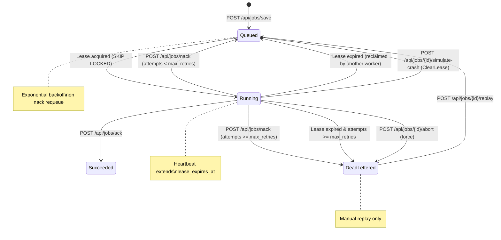

# Distributed Job Queue

A distributed job queue system built with .NET 8, PostgreSQL, and a React TypeScript UI. Features lease-based concurrency control, exponential backoff retries, dead-letter queue with replay, worker heartbeats, and comprehensive observability.

## Architecture

```
┌─────────────────────────────────────────────────────────────────────────────┐
│                              CLIENTS                                         │
│  ┌─────────────┐  ┌─────────────┐  ┌─────────────┐  ┌─────────────────────┐ │
│  │  Producer   │  │  Producer   │  │   UI/CLI    │  │  Monitoring         │ │
│  │  (HTTP)     │  │  (HTTP)     │  │  (React)    │  │  (Prometheus)       │ │
│  └──────┬──────┘  └──────┬──────┘  └──────┬──────┘  └──────────┬──────────┘ │
└─────────┼────────────────┼────────────────┼────────────────────┼────────────┘
          │                │                │                    │
          ▼                ▼                ▼                    ▼
┌─────────────────────────────────────────────────────────────────────────────┐
│                        MAIN API (Port 5033)                                 │
│  ┌──────────────────────────────────────────────────────────────────────┐  │
│  │  JobsController                                                        │  │
│  │  POST /api/jobs/save      - Create job                                │  │
│  │  POST /api/jobs/lease     - Acquire lease (SKIP LOCKED)              │  │
│  │  POST /api/jobs/ack       - Acknowledge success                      │  │
│  │  POST /api/jobs/nack      - Negative ack with retry/backoff          │  │
│  │  POST /api/jobs/heartbeat - Extend lease                             │  │
│  │  GET  /api/jobs           - List/filter jobs                         │  │
│  │  GET  /api/jobs/{id}      - Get job details                          │  │
│  │  POST /api/jobs/{id}/replay - Replay dead-lettered                   │  │
│  │  POST /api/jobs/{id}/abort  - Force abort running job                │  │
│  └──────────────────────────────────────────────────────────────────────┘  │
│  ┌──────────────┐  ┌──────────────┐  ┌──────────────┐  ┌──────────────┐  │
│  │ PostgresStore│  │   Metrics    │  │ HealthChecks │  │  QueueDepth  │  │
│  │ (Dapper)     │  │ (Prometheus) │  │  (PG/self)   │  │  Updater     │  │
│  └──────┬───────┘  └──────┬───────┘  └──────┬───────┘  └──────┬───────┘  │
└─────────┼─────────────────┼─────────────────┼─────────────────┼────────────┘
          │                 │                 │                 │
          ▼                 ▼                 ▼                 ▼
┌─────────────────────────────────────────────────────────────────────────────┐
│                      POSTGRESQL 18 (Port 5432)                              │
│  ┌─────────────────────┐  ┌─────────────────────────────────────────────┐  │
│  │      jobs           │  │              job_attempts                   │  │
│  │  id (PK)            │  │  id (PK)                                    │  │
│  │  type               │  │  job_id (FK)                                │  │
│  │  payload (JSONB)    │  │  attempt_num                                │  │
│  │  status             │  │  worker_id                                  │  │
│  │  priority           │  │  outcome (succeeded|failed|timed_out|running)│ │
│  │  attempts/max_retries│  │  error                                     │  │
│  │  leased_by          │  │  started_at / finished_at                  │  │
│  │  lease_expires_at   │  └─────────────────────────────────────────────┘  │
│  │  run_after          │                                                 │
│  │  created_at         │                                                 │
│  │  finished_at        │                                                 │
│  └─────────────────────┘                                                 │
└─────────────────────────────────────────────────────────────────────────────┘
          ▲
          │ HTTP
          │
┌─────────┴─────────────────────────────────────────────────────────────────────┐
│                        WORKER SERVICE (Port 5000)                             │
│  ┌──────────────────────────────────────────────────────────────────────┐  │
│  │  WorkerLoop (IHostedService)                                         │  │
│  │  1. Lease job from Main API                                          │  │
│  │  2. Start HeartbeatService for lease extension                       │  │
│  │  3. Execute handler (email/sms/report/ach)                          │  │
│  │  4. Ack/Nack via Main API                                            │  │
│  │  5. Loop                                                             │  │
│  └──────────────────────────────────────────────────────────────────────┘  │
│  ┌──────────────┐  ┌──────────────┐  ┌──────────────┐  ┌──────────────┐  │
│  │ HandlerRegistry│  │ HeartbeatSvc │  │  Admin API   │  │  Metrics     │  │
│  │ (email/sms/   │  │ (lease/2 sec)│  │ /admin/*     │  │ (Prometheus) │  │
│  │  report/ach)   │  │              │  │              │  │              │  │
│  └──────────────┘  └──────────────┘  └──────────────┘  └──────────────┘  │
└─────────────────────────────────────────────────────────────────────────────┘
```

## Job State Machine



### Status Definitions

| Status | Description |
|--------|-------------|
| `Queued` | Waiting for worker, eligible for lease |
| `Running` | Leased to worker, heartbeat active |
| `Succeeded` | Completed successfully (terminal) |
| `DeadLettered` | Max retries exceeded (terminal, replayable) |

### Key Transitions

- **Lease Acquisition**: `FOR UPDATE SKIP LOCKED` ensures no duplicate leases
- **Lease Expiry**: Background reclaim increments `attempts`, creates new attempt audit record, marks previous as `timed_out`
- **Exponential Backoff**: `run_after = now() + min(2^attempts, 60s) + jitter`
- **Heartbeat**: Worker extends lease at `leaseDuration/2` interval

## Quick Start

### Prerequisites

- .NET 8 SDK
- Docker (for PostgreSQL)
- Node.js 18+ (for UI)

### 1. Start PostgreSQL

```bash
docker compose up -d
# Verifies: docker ps | grep dist_job_queue
```

### 2. Initialize Database

```bash
# Run once to create schema
docker exec -i dist_job_queue psql -U job_queue_user -d job_queue_db < db/JobQueueDbInit.sql

# Reset for testing (clears jobs table)
./scripts/initdbfortests.sh
```

### 3. Start Main API (Terminal 1)

```bash
dotnet run --project DistributedJobQueue.Api/DistributedJobQueue.Api.csproj
# Runs on http://localhost:5033
# Swagger: http://localhost:5033/swagger
# Metrics: http://localhost:5033/metrics
```

### 4. Start Worker (Terminal 2)

```bash
dotnet run --project DistributedJobQueue.Worker/DistributedJobQueue.Worker.csproj
# Runs on http://localhost:5000
# Configured to call Main API at http://localhost:5033
```

### 5. Start UI (Terminal 3)

```bash
cd DistributedJobQueue.UI
npm install
npm run dev
# Runs on http://localhost:5173 (proxies /api to Main API)
```

## Running Tests

### ConsoleTester (Integration Tests)

```bash
# Ensure DB is clean
./scripts/initdbfortests.sh

cd DistributedJobQueueBrokerService
dotnet run --project DistributedJobQueue.ConsoleTester.csproj
# Runs 10 integration tests as IHostedService
# Press Ctrl+C to stop after completion
```

### Test Scenarios (10 Tests)

| Test | Description |
|------|-------------|
| `AckSuccessTest` | Happy path: lease → ack → succeeded |
| `AckWrongWorkerTest` | Reject ack from non-lease holder |
| `NackRetryTest` | Nack requeues with backoff |
| `NackExhaustsRetriesTest` | Max retries → DeadLettered |
| `VisibilityTestAsync` | Lease not visible to other workers |
| `ExpiredLeaseTest` | Expired lease reclaimed by another worker |
| `OrphanExhaustsRetriesTest` | Orphaned running job exhausts retries |
| `ConcurrentLeaseNoDuplicatesTest` | SKIP LOCKED prevents double-lease |
| `IdempotencyKeyDedupeTest` | Duplicate submit returns same ID |
| `HeartbeatExtendsLeaseTest` | Heartbeat keeps lease alive |

## API Examples

### Create Job

```bash
curl -X POST http://localhost:5033/api/jobs/save \
  -H "Content-Type: application/json" \
  -d '{"type": "email", "payload": "{\"to\":\"user@example.com\"}", "maxRetries": 3}'
```

### Lease Job (Worker)

```bash
curl -X POST http://localhost:5033/api/jobs/lease \
  -H "Content-Type: application/json" \
  -d '{"workerId": "worker-1", "allowedTypes": ["email"], "leaseSeconds": 30}'
```

### Acknowledge

```bash
curl -X POST http://localhost:5033/api/jobs/ack \
  -H "Content-Type: application/json" \
  -d '{"jobId": "<guid>", "workerId": "worker-1", "resultUrl": "s3://results/..."}'
```

### Negative Acknowledge

```bash
curl -X POST http://localhost:5033/api/jobs/nack \
  -H "Content-Type: application/json" \
  -d '{"jobId": "<guid>", "workerId": "worker-1", "error": "SMTP timeout"}'
```

### List Jobs

```bash
curl "http://localhost:5033/api/jobs?status=Running&type=email"
```

### Replay Dead-Lettered

```bash
curl -X POST http://localhost:5033/api/jobs/<guid>/replay
```

## UI Features

- **Dashboard**: Live queue counts, Prometheus metrics charts (throughput, latency, retry rate)
- **Jobs Page**: Sortable/filterable table, treemap view, job dispatch form, detail modal with attempts
- **Test Scenarios**: 10 one-click integration test triggers
- **Worker Panel**: Pool status, admin controls (shutdown, heartbeat config)
- **Dark Mode**: Persisted toggle with full chart/axis support

## Configuration

### Main API (`DistributedJobQueue.Api/appsettings.json`)

```json
{
  "ConnectionStrings": {
    "JobQueueDb": "Host=localhost;Port=5432;Database=job_queue_db;Username=job_queue_user;Password=job_queue_pass"
  },
  "QUEUE_DEPTH_UPDATE_INTERVAL_SECONDS": 15
}
```

### Worker (`DistributedJobQueue.Worker/appsettings.json`)

```json
{
  "ApiBaseUrl": "http://localhost:5033",
  "Worker": {
    "WorkerId": "worker-1",
    "AllowedTypes": ["email", "sms", "report", "ach"],
    "LeaseSeconds": 30
  }
}
```

## Project Structure

```
DistributedJobQueue/
├── BrokerService/              # Core library (Domain, Persistence)
│   ├── Domain/                 # Job, JobStatus, LeasedJob, JobAttempt
│   └── Persistence/            # PostgresStore, IJobStore
├── DistributedJobQueue.Api/    # Main ASP.NET Core API (port 5033)
├── DistributedJobQueue.Worker/ # Worker service (port 5000)
├── DistributedJobQueue.UI/     # React 18 + Vite + TypeScript UI
├── DistributedJobQueueBrokerService/ # ConsoleTester integration tests
├── db/JobQueueDbInit.sql       # Database schema
├── docker-compose.yaml         # PostgreSQL 18
├── scripts/initdbfortests.sh   # Test DB reset
└── README.md                   # This file
```

## Known Behaviors

- **Prometheus metrics are cumulative**: Dashboard charts show all-time totals; StatusCards show live queue state
- **Lease reclaim audit**: Previous attempt marked `timed_out`, new attempt created (no double-count)
- **Idempotency**: `idempotency_key` prevents duplicate job creation
- **Priority**: Higher priority jobs leased first (within same type)

## License

MIT